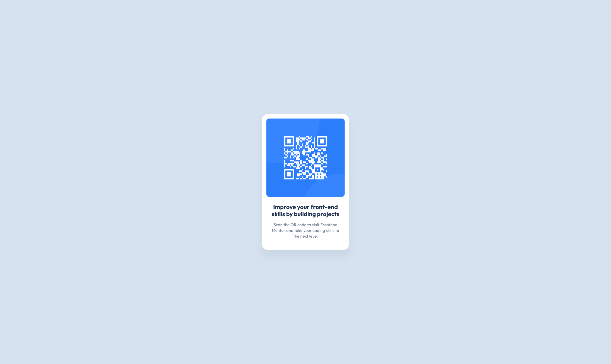

# Frontend Mentor - QR code component solution

This is a solution to the [QR code component challenge on Frontend Mentor](https://www.frontendmentor.io/challenges/qr-code-component-iux_sIO_H). Frontend Mentor challenges help you improve your coding skills by building realistic projects.

## Table of contents

- [Overview](#overview)
  - [Screenshot](#screenshot)
  - [Links](#links)
- [My process](#my-process)
  - [Built with](#built-with)
  - [What I learned](#what-i-learned)
  - [Continued development](#continued-development)
  - [Useful resources](#useful-resources)
  - [AI Collaboration](#ai-collaboration)
- [Author](#author)
- [Acknowledgments](#acknowledgments)

## Overview

The goal of this project was to bouild a QR code component that matches the original Frontend Mentor Design.

### Screenshot

### Links

- Solution URL: [GitHub repository](https://github.com/abel-bd96/qr-code-component)
- Live Site URL: [GitHub Pages Live Site](https://abel-bd96.github.io/qr-code-component/)

## My process

### Built with

- Semantic HTML5 markup
- CSS custom properties
- Flexbox
- Mobile-first workflow
- BEM approach for CSS

### What I learned

I learned how to use a professional tool such as Figma to parse a design to code, how design systems looks like and how to navigate the designs.

This project also helped me to prove my knowldege of semantic HTML and CSS, speacially with Flexbox. This is especially important to me, because helps me to feel confident with my skills beyond the tutorials and courses. Finally I can say that I built something by my own.

### Continued development

I want to continue improving my CSS skills, especially responsive design, and he use of reusable CSS custom properties.

**Note: Delete this note and the content within this section and replace with your own plans for continued development.**

### Useful resources

- [Paul Irish *{Box-sizing: Border-box} FTW](https://www.paulirish.com/2012/box-sizing-border-box-ftw/) - This site helpeed me by providing the code to apply a natural box layout to my elements.

### AI Collaboration

I used Grok to ask about how to apply gap and even helped by telling me what to check for accessibilitty.

## Author

- GitHub - [Abel Beltrán](https://github.com/abel-bd96)
- Frontend Mentor - [@abel-bd96](https://www.frontendmentor.io/profile/abel-bd96)
- X - [@abel-bd](https://www.x.com/abel_bd)

## Acknowledgments

Thanks to Frontend Mentor for providing this challenge and helping developers practice their frontend development skills through hands-on projects.
